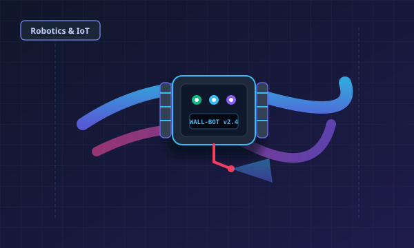

# Soumyadeep Pal — Personal Developer Portfolio

A modern, high-performance personal portfolio website built with clean **HTML5**, **CSS3**, and **Vanilla JavaScript**. Designed with a dark theme aesthetic, glowing accent gradients, responsive typography, glassmorphism, and seamless FormSubmit integration for direct email contact.



---

## 🌟 Key Highlights

- **Executive Dark/Light Mode**: High-contrast, accessibility-focused color palette with persistent theme storage in `localStorage`.
- **Zero Heavy Dependencies**: Pure semantic HTML5, modern CSS with custom properties (CSS variables), and vanilla JavaScript. No node modules, build steps, or frameworks required.
- **Ultra-Responsive**: Fluid clamp typography and adaptive layout optimized across mobile phones, tablets, laptops, and ultra-wide desktop monitors.
- **Interactive Micro-Animations**: Smooth anchor navigation, section spy via `IntersectionObserver`, hover lifts, and glowing cards.
- **Production-Ready Contact Engine**: Strictly two-field contact form (`email` and `message`) wired directly to [FormSubmit](https://formsubmit.co) with honeypot spam protection, real AJAX feedback, and zero login barriers.
- **GitHub Pages Ready**: 100% compatible with static hosting on GitHub Pages, Vercel, Netlify, or Apache/Nginx.

---

## 📁 Repository Structure

```text
portfolio/
│
├── index.html                  # Semantic, accessible HTML5 single-page structure
├── css/
│   └── style.css               # Modern CSS variables, glassmorphism, responsive styles
├── js/
│   └── script.js               # Theme toggle, scroll observer, FormSubmit AJAX, clipboard
├── assets/
│   ├── images/
│   │   ├── profile-placeholder.svg # High-res developer avatar graphic
│   │   ├── wallbot.svg         # Wall climbing painting robot graphic
│   │   ├── eventiq.svg         # EventIQ management web app graphic
│   │   ├── smart-factory.svg   # Smart factory IoT telemetry dashboard graphic
│   │   └── train-reservation.svg # Train reservation engine graphic
│   └── icons/
│       ├── favicon.svg         # Stylized monogram brand favicon
│       ├── github.svg          # GitHub SVG icon
│       ├── linkedin.svg        # LinkedIn SVG icon
│       └── mail.svg            # Mail SVG icon
└── README.md                   # Comprehensive documentation & setup instructions
```

---

## 🚀 Sections Overview

1. **Home (Hero)**: High-impact introduction, live availability indicator, CTA buttons (*"Explore My Work"*, *"Contact Me"*), and avatar illustration.
2. **About Me**: Academic narrative at IEM Kolkata, software engineering interests, and key milestone highlights.
3. **Skills**: Modular skill cards covering Python, C, JavaScript, HTML5, CSS3, MySQL, Git & GitHub.
4. **Projects**: Showcase cards featuring descriptions, architecture tags, and repository links for:
   - **WallBot**: Wall climbing painting robot (Robotics & IoT).
   - **EventIQ**: Event management website (Modern Web Platform).
   - **Smart Factory Dashboard**: Industrial IoT monitoring dashboard with live telemetry.
   - **Train Reservation System**: High-reliability transaction and coach allotment system.
5. **Achievements**: NPTEL Elite + Silver certification, hackathon participation, and academic distinctions.
6. **Education**: B.Tech in Information Technology from the Institute of Engineering and Management (IEM), Kolkata.
7. **Contact Me**: FormSubmit-powered contact form with email & message fields, honeypot spam trap, and instant copy email button.
8. **Footer**: Social profiles, copyright notice, and smooth back-to-top button.

---

## 📬 FormSubmit Configuration & Email Verification

The contact form is connected to FormSubmit at:
```text
https://formsubmit.co/soumyadeepp830@gmail.com
```

### How to Activate FormSubmit (One-Time Step):
When the first form submission is triggered:
1. Open the portfolio website and submit a test message with your email.
2. FormSubmit will send a **one-time activation email** to `soumyadeepp830@gmail.com` with the subject:
   > *"Action Required: Activate FormSubmit"*
3. Open your inbox, click the **"Activate Form"** button inside the email.
4. **Done!** From that moment forward, every visitor submission will be delivered immediately to your inbox with the sender's email address set as the `Reply-To`.

### Form Security & UX Features:
- **Honeypot Spam Protection**: An invisible `_honey` field automatically traps spam bots without bothering human visitors with irritating captchas.
- **AJAX Delivery**: Submits asynchronously in the background so visitors never leave your page.
- **Strict 2-Field Design**: Requires only the visitor's `email` and `message` to minimize friction.

---

## 🛠️ How to Run Locally

You can test and view the website locally using any standard browser:

### Option 1: Direct File Open
Simply double-click `portfolio/index.html` in your file explorer or open it in Chrome, Edge, Firefox, or Safari.

### Option 2: Using Python HTTP Server (Recommended)
Open PowerShell or Terminal in the `portfolio` folder and run:
```powershell
# In PowerShell:
cd d:\SoumyadeepPal\portfolio
python -m http.server 8080
```
Then visit `http://localhost:8080` in your browser.

### Option 3: VS Code Live Server
1. Open the `portfolio` folder in VS Code.
2. Click **Go Live** on the bottom status bar to run via Live Server.

---

## 🌐 Deploying to GitHub Pages

To publish your portfolio online for free with a custom URL (e.g. `https://soumyadeeppal.github.io`):

1. **Push your code to GitHub**:
   ```bash
   git add .
   git commit -m "feat: complete modern portfolio website"
   git push origin main
   ```

2. **Enable GitHub Pages**:
   - Go to your repository on GitHub (`https://github.com/SoumyadeepPal/SoumyadeepPal`).
   - Click on **Settings** > **Pages** (in the left sidebar).
   - Under **Build and deployment** > **Source**, choose **Deploy from a branch**.
   - Select **Branch**: `main` and Folder: `/ (root)`.
   - Click **Save**.

3. **Visit your live site**:
   - Within 1–2 minutes, your website will be live at:
     `https://<your-username>.github.io/<repository-name>/`

---

## 🎨 Personal Customization

- **Profile Picture**: Replace `assets/images/profile-placeholder.svg` with your actual photo (e.g., `assets/images/profile.jpg`), then update line 147 in `portfolio/index.html`:
  ```html
  
  ```
- **Social Links**: Update your LinkedIn profile URL in `portfolio/index.html` (search for `linkedin.com/in/soumyadeep-pal`).
- **Project Repositories**: Update the repository URLs in the `#projects` section when your GitHub repositories are ready.

---

## 📄 License
This portfolio is created for **Soumyadeep Pal**. Feel free to customize and expand it!

